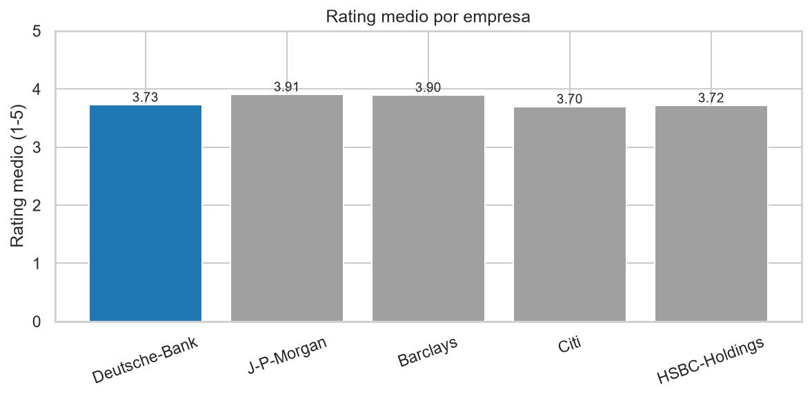
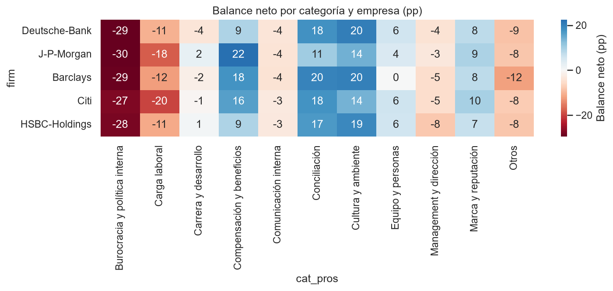
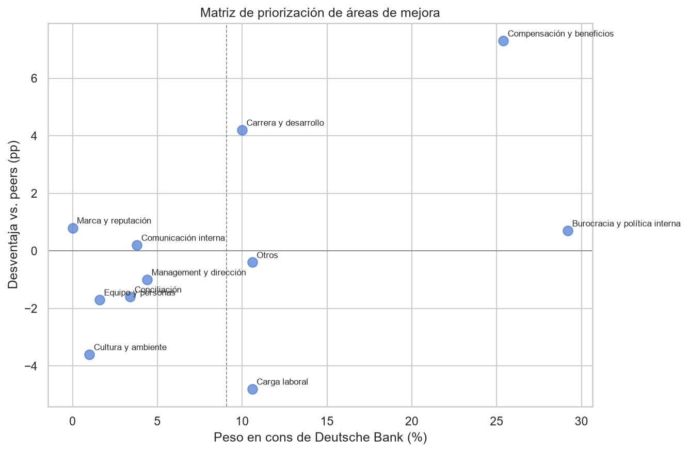
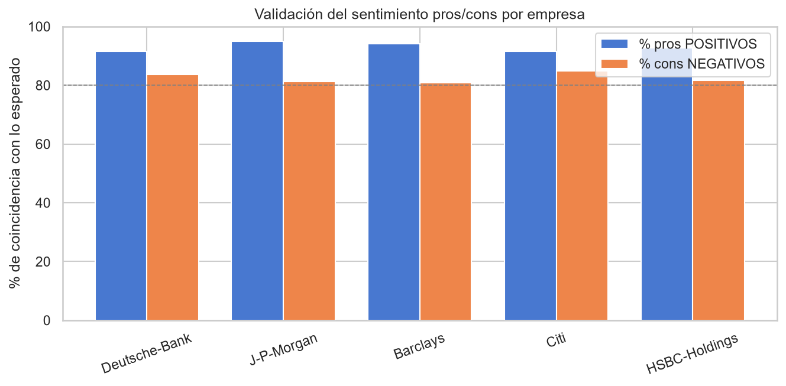

# 🏦 Diagnóstico de Marca Empleadora — Deutsche Bank vs. peers

Análisis de NLP sobre 2.500 reseñas de Glassdoor para identificar fortalezas y áreas de mejora de Deutsche Bank como empleador, comparándolo con cuatro bancos competidores.

> Caso práctico de NLP aplicado a Recursos Humanos — también usado como pieza de portafolio de análisis de datos.


---

## 📌 Qué responde este análisis

- **¿Está Deutsche Bank mejor o peor valorado que sus competidores?** → EDA comparativo
- **¿Qué categorías destacan en pros y en cons?** → Topic modeling con BERTopic
- **¿Qué áreas son fortalezas relativas y cuáles debilidades?** → Balance neto vs peers
- **¿Qué motivos empujan a los empleados a irse?** → Análisis de cons de ex-empleados
- **¿Qué palancas debería activar RRHH?** → Matriz de priorización y recomendaciones

## 🖼️ Vistazo al análisis

| Rating medio vs peers | Balance neto por categoría |
|---|---|
|  |  |

| Matriz de priorización | Validación del sentimiento |
|---|---|
|  |  |

## 📊 Fuentes de datos

Reseñas públicas de [Glassdoor Job Reviews 1 & 2](https://www.kaggle.com/datasets/davidgauthier/glassdoor-job-reviews) (David Gauthier, Kaggle), preparadas por el profesor del curso como un único fichero Parquet.

| Variable | Descripción |
|---|---|
| `firm` | Nombre de la empresa en Glassdoor |
| `date_review` | Fecha de la reseña |
| `current` | Situación del empleado (actual/antiguo) + antigüedad |
| `overall_rating` | Rating global (1-5) |
| `recommend` | Recomendación (v= sí, o=neutral, x=no) |
| `pros` | Texto libre: puntos positivos |
| `cons` | Texto libre: puntos negativos |

**Ventana temporal:** últimos 5 años del dataset combinado (2018–2023).
**Filtro aplicado:** empresas con ≥300 reseñas. **Muestra final:** 2.500 reseñas (500 por empresa).

El fichero `glassdoor_reviews_hr.parquet` no se incluye en el repositorio (demasiado grande). Descárgalo desde Kaggle y colócalo en `data/raw/`.

## 🧱 Metodología

Pipeline de NLP en 5 pasos, todo ejecutable en CPU:

1. **Preparación** — separación de `current` en situación y antigüedad, limpieza de textos.
2. **Sentimiento** — `distilbert-base-uncased-finetuned-sst-2-english` sobre pros y cons por separado, con `truncation=True`. Validación: 92% de pros clasificados como positivos, 82% de cons como negativos.
3. **Topic modeling** — un único modelo BERTopic para las 5 empresas juntas (uno para pros, otro para cons). Embeddings con `all-MiniLM-L6-v2`. Reducción de outliers con c-TF-IDF.
4. **Categorización** — mapeo manual + auto-categorización por palabras clave a 9 categorías de negocio (Compensación, Conciliación, Cultura, Carrera, Marca, Equipo, Burocracia, Carga laboral, Comunicación).
5. **Comparación con peers** — balance neto (`% pros − % cons`) y gap frente a la media de peers.

## 🧮 Métricas destacadas

- **Balance neto** — cuánto domina una categoría en pros vs cons, por empresa
- **Gap vs peers** — diferencia de balance neto entre DB y la media de sus 4 competidores
- **Desventaja vs peers** — inverso del gap, para la matriz de priorización
- **Rating por categoría** — contraste: ¿las reseñas que se quejan de X tienen peor rating?

## 🖱️ Insights principales

| Fortalezas de DB | Debilidades de DB |
|---|---|
| Cultura y ambiente (+10.2 pp vs peers) | Compensación y beneficios (−14.2 pp) |
| Carga laboral (+3.4 pp) | Management y dirección (−3.0 pp) |
| Conciliación (+3.1 pp) | Marca y reputación (−1.1 pp) |

**Motivo de salida #1 de DB:** Burocracia y política interna (26.8% de los cons de ex-empleados).

## 📂 Estructura del repositorio
```text
NLP_Diagnóstico de Marca Empleadora/
│
├── .gitignore
├── README.md
├── requirements.txt
│
├── data/
│   ├── processed/                              # dataset preparado
│   │   └── resenas_preparadas.parquet      
│   └── raw/
│       └── glassdoor_reviews_hr.parquet        # no se sube
├── docs/
│   ├── Analisis de reseñas (plantilla)2.pdf
│   └── Caso_Practico_NLP_Glassdoor_RRHH.pdf
├── notebooks/                                  # dataset preparado
│   ├── diagnostico_marca_empleadora.ipynb      # pipeline completo, ejecutable
│   └── generar_presentacion.py                 # entregable principal
├── outputs/
│   ├── figures/                                # 10 figuras PNG
│   ├── reports/
│   │   └── ejecucion.log                       # logs de ejecución
│   └── tables/                                 # 7 tablas CSV
└── presentation/
    └── Diagnostico_Marca_Empleadora.pptx
```

## 🛠️ Herramientas

Python · pandas · Hugging Face Transformers · BERTopic · sentence-transformers · UMAP · HDBSCAN · matplotlib · seaborn

## ⚙️ Cómo reproducirlo

```bash
# 1. Clonar el repositorio
git clone https://github.com/<tu-usuario>/NLP-Diagnostico-Marca-Empleadora.git
cd NPL-Diagnostico-Marca-Empleadora

# 2. Crear entorno virtual
python -m venv .venv
.venv/Scripts/activate    # Windows
# source .venv/bin/activate  # Linux/Mac

# 3. Instalar dependencias
pip install -r requirements.txt

# 4. Colocar el parquet en data/raw/glassdoor_reviews_hr.parquet

# 5. Ejecutar el pipeline completo
python notebooks/diagnostico_marca_empleadora.py

Tiempo de ejecución: ~10-15 min en CPU (2500 reseñas, sentimiento + BERTopic).

👤 Autor
Adrian Justo Carballal — [(https://adrianjusto-data.github.io/)]


Este proyecto usa datos públicos de Glassdoor con fines educativos y de portafolio. Las conclusiones son orientativas y no sustituyen encuestas internas de clima laboral.